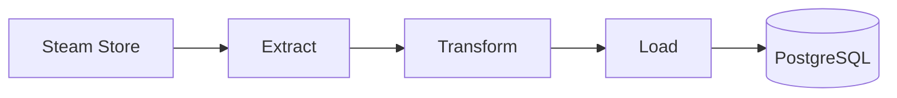

<div align="center">


# 🎮 steam-deals-etl

**Pipeline ETL que coleta as promoções em destaque da Steam e guarda o histórico de preços em um banco PostgreSQL.**


</div>

---

## Sobre o projeto

Este projeto coleta as promoções em destaque da Steam e grava o preço de cada jogo a cada execução. Rodando uma vez por dia, o histórico acumulado permite responder perguntas como "quando esse jogo ficou mais barato?".

1. **Extract**: busca a lista de destaques da loja (categorias `specials`, `top_sellers` e `new_releases`), mantém só os **jogos com desconto** (descarta pacotes e itens sem promoção) e remove repetidos pelo `appid`. Tem retry em caso de falha de conexão.
2. **Transform**: converte os preços de centavos para reais com `Decimal`, a data de expiração para `datetime` e registra a data da coleta. Descarta registros inconsistentes, como preço final maior que o original.
3. **Load**: grava nas tabelas `games` e `promotions` do **PostgreSQL**. Rodar o pipeline mais de uma vez no mesmo dia não duplica nada.

### Limitações

- **A fonte não é uma API oficial.** O endereço usado (`/api/featuredcategories/`) não é documentado pela Steam e pode mudar sem aviso.
- **A lista cobre só uma fatia.** O endpoint devolve promoções selecionadas pela loja, e não todos os jogos em desconto.
- Os preços vêm em **reais** (`cc=br`).
- A execução é **manual** por enquanto. O agendamento automático está nos próximos passos.

---

## Fluxo



## Modelo de dados

Duas tabelas, porque o nome do jogo não muda todo dia e não precisa ser repetido em cada linha:

- **`games`**: uma linha por jogo (`appid`, `name`). Se o nome mudar, o Load atualiza.
- **`promotions`**: uma linha por jogo **por dia** (`appid`, `collection_date`, `original_price`, `final_price`, `discount_percent`, `expiration`), com a regra `UNIQUE (appid, collection_date)` e chave estrangeira para `games`.

## Estrutura

```
steam-deals-etl/
├── extract.py        # busca e filtra as promoções, com retry
├── transform.py      # converte preços e datas, descarta dados inconsistentes
├── load.py           # conecta ao PostgreSQL e grava as tabelas
├── main.py           # junta as etapas e executa o pipeline
├── sql/schema.sql    # criação das tabelas games e promotions
├── .env.example      # modelo das variáveis de ambiente
└── requirements.txt  # dependências
```

## Como rodar

1. Clone o repositório e entre na pasta.
2. Crie e ative o ambiente virtual:
   `python3 -m venv .venv` e `source .venv/bin/activate`
   (no fish: `source .venv/bin/activate.fish`)
3. Instale as dependências: `pip install -r requirements.txt`
4. Copie `.env.example` para `.env` e preencha com os dados do seu PostgreSQL.
5. Crie o banco `steam_etl` e as tabelas:
   `psql -c "CREATE DATABASE steam_etl;"` e `psql -d steam_etl -f sql/schema.sql`
6. Execute: `python main.py`

Rodar de novo no mesmo dia grava **0** linhas novas, porque as promoções de hoje já existem.

## Exemplo de consulta

```sql
SELECT
    t2.name AS game_name,
    t1.*
FROM promotions AS t1
JOIN games AS t2 USING (appid)
ORDER BY t1.discount_percent DESC;
```

## Próximos passos

- Agendar a coleta diária de forma automática (Docker e Apache Airflow).
- Testes automáticos com `pytest` para o Extract e o Transform.
- Checagens de qualidade antes do Load (por exemplo, falhar se nenhuma promoção for extraída).
- Usar o endpoint `appdetails` para cobrir mais jogos, respeitando o limite de requisições.
