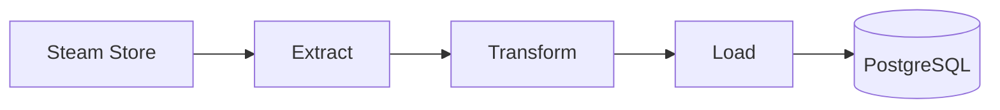

<div align="center">

[🇧🇷 Português](README_PT.md)


# 🎮 steam-deals-etl

**ETL pipeline that collects featured Steam deals and stores the price history in a PostgreSQL database.**


</div>

---

## About the project

This project collects the featured deals on Steam and records the price of each game on every run. Run once a day, the accumulated history can answer questions like "when was this game at its lowest price?".

1. **Extract**: fetches the store's featured list (the `specials`, `top_sellers` and `new_releases` categories), keeps only **discounted games** (bundles and items without a deal are dropped) and removes duplicates by `appid`. It retries on connection failures.
2. **Transform**: converts prices from cents to reais using `Decimal`, converts the expiration timestamp to `datetime` and records the collection date. Inconsistent records, such as a final price higher than the original, are discarded.
3. **Load**: writes to the `games` and `promotions` tables in **PostgreSQL**. Running the pipeline more than once on the same day does not create duplicates.

### Limitations

- **The source is not an official API.** The endpoint used (`/api/featuredcategories/`) is not documented by Steam and may change without notice.
- **The list covers only a slice of the store.** The endpoint returns deals selected by Steam, not every discounted game.
- Prices are in **Brazilian reais** (`cc=br`).
- Execution is **manual** for now. Automatic scheduling is listed under next steps.

---

## Flow



## Data model

Two tables, because a game's name does not change every day and does not need to be repeated on every row:

- **`games`**: one row per game (`appid`, `name`). If the name changes, the Load step updates it.
- **`promotions`**: one row per game **per day** (`appid`, `collection_date`, `original_price`, `final_price`, `discount_percent`, `expiration`), with a `UNIQUE (appid, collection_date)` constraint and a foreign key to `games`.

## Project structure

```
steam-deals-etl/
├── extract.py        # fetches and filters the deals, with retry
├── transform.py      # converts prices and dates, discards inconsistent data
├── load.py           # connects to PostgreSQL and writes the tables
├── main.py           # chains the steps and runs the pipeline
├── sql/schema.sql    # creates the games and promotions tables
├── .env.example      # template for the environment variables
└── requirements.txt  # dependencies
```

## How to run

1. Clone the repository and enter the folder.
2. Create and activate a virtual environment:
   `python3 -m venv .venv` and `source .venv/bin/activate`
   (on fish: `source .venv/bin/activate.fish`)
3. Install the dependencies: `pip install -r requirements.txt`
4. Copy `.env.example` to `.env` and fill it in with your PostgreSQL details.
5. Create the `steam_etl` database and the tables:
   `psql -c "CREATE DATABASE steam_etl;"` and `psql -d steam_etl -f sql/schema.sql`
6. Run: `python main.py`

Running it again on the same day writes **0** new rows, because today's deals already exist.

## Example query

```sql
SELECT
    t2.name AS game_name,
    t1.*
FROM promotions AS t1
JOIN games AS t2 USING (appid)
ORDER BY t1.discount_percent DESC;
```

## Next steps

- Run the pipeline automatically every day (Docker and Apache Airflow).
- Add automated tests for Extract and Transform with `pytest`.
- Add data quality checks before loading (for example, fail if no deals are extracted).
- Cover more games using the `appdetails` endpoint, respecting rate limits.
